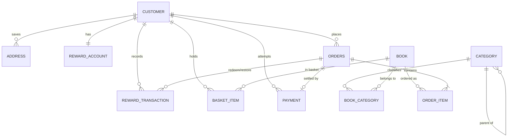

# Data Model (for review): BookyGeek

**Feature**: `001-bookygeek-platform` | **Date**: 2026-11-12 | **Plan**: [plan.md](plan.md)

> **Status: APPROVED — GATE G-DM (project owner, 2026-11-12).** Constitution
> Principle V and NFR-DAT-04 require approval before any backend implementation. Review points **RP-1** (keep
> `reward_transaction`) and **RP-2** (no `basket` header table) are **OWNER APPROVED**. This is a design
> description, not SQL: **no migration scripts exist or are produced in the planning phase.** Approved content
> becomes Flyway `V1__…` scripts in implementation.

Scope rule (OD-12): only entities/fields needed by confirmed functionality. Not modelled: coupon, wallet,
wishlist, author profile, genre, brand, role/permission, shipment, admin. The `review` table (§2.12) was added by AMD-002.

Conventions: surrogate `BIGINT GENERATED … AS IDENTITY` primary keys (except where a natural key is stated);
timestamps `TIMESTAMPTZ` stored in UTC; money `NUMERIC(12,2)`; every FK enforced; names are `snake_case`;
Hibernate `ddl-auto=validate` (never update/create). "Owner" = backend module that may use the table via its
own repositories (Principle II); other modules go through that module's service. Cross-module FKs exist only
at database level.

## 1. Entity overview

## 2. Tables

### 2.1 `customer` — owner: User & Authentication
| Column | Type | Constraints / notes |
|---|---|---|
| id | BIGINT | PK |
| full_name | VARCHAR(100) | NOT NULL, non-blank |
| email | VARCHAR(254) | NOT NULL, **UNIQUE**; stored trimmed + lower-cased (CL-18 case-insensitive uniqueness) |
| password_hash | VARCHAR(255) | NOT NULL; salted adaptive hash only (NFR-SEC-01) |
| token_version | INTEGER | NOT NULL DEFAULT 0; incremented on logout to invalidate issued JWTs (FR-AUTH-05) |
| created_at | TIMESTAMPTZ | NOT NULL |

### 2.2 `address` — owner: User & Authentication (FR-CHK-02/03)
| Column | Type | Constraints / notes |
|---|---|---|
| id | BIGINT | PK |
| customer_id | BIGINT | NOT NULL, FK → customer ON DELETE CASCADE; index |
| full_name | VARCHAR(100) | NOT NULL |
| phone | CHAR(10) | NOT NULL, CHECK `~ '^[0-9]{10}$'` |
| address_line1 | VARCHAR(150) | NOT NULL |
| address_line2 | VARCHAR(150) | NULL (optional) |
| city | VARCHAR(80) | NOT NULL |
| state | VARCHAR(60) | NOT NULL (validated against the India list when country = India) |
| pin_code | CHAR(6) | NOT NULL, CHECK `~ '^[0-9]{6}$'` |
| country | VARCHAR(56) | NOT NULL DEFAULT 'India' |
| created_at / updated_at | TIMESTAMPTZ | NOT NULL |

### 2.3 `reward_account` — owner: Reward Points
| Column | Type | Constraints / notes |
|---|---|---|
| customer_id | BIGINT | PK and FK → customer ON DELETE CASCADE (one account per customer) |
| balance | INTEGER | NOT NULL, **CHECK balance ≥ 0**. Initial value from `bookygeek.rewards.initial-points` (1,000). Row-locked (`FOR UPDATE`) during redeem/restore. |

### 2.4 `reward_transaction` — owner: Reward Points (movements; there is **no earn** type) — **RP-1: OWNER APPROVED (keep)**
| Column | Type | Constraints / notes |
|---|---|---|
| id | BIGINT | PK |
| customer_id | BIGINT | NOT NULL, FK → customer; index. Derivable from `order_id`, but kept so the Reward module can read a customer's movements without reading `orders` (owned by Order, Principle II) |
| order_id | BIGINT | NOT NULL, FK → orders |
| type | VARCHAR(10) | NOT NULL, CHECK IN (`REDEEM`,`RESTORE`) |
| points | INTEGER | NOT NULL, CHECK points > 0 |
| created_at | TIMESTAMPTZ | NOT NULL |
| | | UNIQUE (order_id, type): at most one redeem and one restore per order |

Row-creation rules (the `CHECK points > 0` constraint is kept, so a zero-point row can never exist):
- A `REDEEM` row is inserted **only when the order's `points_redeemed > 0`**, with `points = points_redeemed`. An order
  placed without points has no `REDEEM` row.
- A `RESTORE` row is inserted **only when points are actually restored** on cancellation, i.e. when the cancelled
  order had a `REDEEM` row (`points_redeemed > 0`), with `points` equal to that amount. Cancelling an order that
  redeemed no points inserts no `RESTORE` row and leaves the balance untouched.

> **Review point RP-1 — OWNER APPROVED: KEEP `reward_transaction`.** The ledger repeats information derivable from
> `orders.points_redeemed` + cancellation, but the spec's "Reward-point record" lists *movements*, and the ledger makes
> NFR-DAT-01 consistency checks (`balance = initial − Σredeem + Σrestore`) provable. Approved rules: `CHECK points > 0`
> retained; `REDEEM` row only when `points_redeemed > 0`; `RESTORE` row only when points are actually restored on
> cancellation; `UNIQUE (order_id, type)` retained.

### 2.5 `category` — owner: Category & Brand
| Column | Type | Constraints / notes |
|---|---|---|
| id | BIGINT | PK |
| name | VARCHAR(80) | NOT NULL, UNIQUE |
| parent_id | BIGINT | NULL, FK → category; NULL = top level. Depth is 2 in seed data (CL-25) |
| sort_order | INTEGER | NOT NULL DEFAULT 0 (sidebar ordering) |
| | | CHECK `parent_id <> id` |

"All" is a UI entry (not stored). Genre tags shown on books are the book's leaf categories (no genre table).

### 2.6 `book` — owner: Book Catalogue
| Column | Type | Constraints / notes |
|---|---|---|
| id | BIGINT | PK |
| title | VARCHAR(200) | NOT NULL |
| author | VARCHAR(120) | NOT NULL (plain text; no author entity — CL-04) |
| description | TEXT | NOT NULL |
| publisher | VARCHAR(120) | NOT NULL — **this is the brand** (CL-02). Index. |
| format | VARCHAR(10) | NOT NULL, CHECK IN (`PAPERBACK`,`HARDCOVER`,`EBOOK`) |
| language | VARCHAR(40) | NOT NULL |
| price | NUMERIC(10,2) | NOT NULL, CHECK price > 0 |
| stock_quantity | INTEGER | NULL for eBooks; **CHECK** `(format='EBOOK' AND stock_quantity IS NULL) OR (format<>'EBOOK' AND stock_quantity IS NOT NULL AND stock_quantity >= 0)` |
| front_cover_url | VARCHAR(255) | NOT NULL |
| back_cover_url | VARCHAR(255) | NULL |
| listed | BOOLEAN | NOT NULL DEFAULT TRUE — a book removed from the catalogue by a data script is un-listed, never deleted, so order history keeps its FK (supports Buy Again "no longer in the catalogue", CL-24) |
| created_at | TIMESTAMPTZ | NOT NULL (used by default Relevance ordering) |

Not stored: delivery date (calculated), rating, copies sold. Indexes: `publisher`, `language`, `format`,
`price`, `listed`. Unavailable = physical with `stock_quantity = 0`.

### 2.7 `book_category` — owner: Book Catalogue (association; FK to category is DB-level only)
| Column | Type | Constraints / notes |
|---|---|---|
| book_id | BIGINT | FK → book ON DELETE CASCADE |
| category_id | BIGINT | FK → category |
| | | PK (book_id, category_id); index on category_id. Books are attached to **leaf** categories only (seed rule). |

### 2.8 `basket_item` — owner: Shopping Cart (persisted customer basket only; guest basket is browser-only)
| Column | Type | Constraints / notes |
|---|---|---|
| customer_id | BIGINT | FK → customer ON DELETE CASCADE |
| book_id | BIGINT | FK → book |
| quantity | INTEGER | NOT NULL, **CHECK quantity BETWEEN 1 AND 10** |
| updated_at | TIMESTAMPTZ | NOT NULL |
| | | PK (customer_id, book_id) — "second add increases quantity, never duplicates a line" |

> **Review point RP-2 — OWNER APPROVED: KEEP the current design**: no `basket` header table — a basket is simply the set of a customer's items. Price is
> **not** stored on the item (always live price, per Buy Again/FR-BSK-08). The stock cap (`≤ stock`) cannot be a
> table CHECK and is enforced in the Cart service and re-checked under lock at order placement.

### 2.9 `orders` — owner: Order Management (named `orders` because `order` is reserved)
| Column | Type | Constraints / notes |
|---|---|---|
| id | BIGINT | PK; display reference derived as `BG-` + zero-padded id (FR-CNF-05; not stored) |
| customer_id | BIGINT | NOT NULL, FK → customer; index `(customer_id, placed_at DESC)` |
| status | VARCHAR(10) | NOT NULL, CHECK IN (`PLACED`,`CANCELLED`); only transition PLACED → CANCELLED |
| placed_at | TIMESTAMPTZ | NOT NULL — anchor of the 48-hour window |
| cancelled_at | TIMESTAMPTZ | NULL; CHECK `(status='CANCELLED') = (cancelled_at IS NOT NULL)` |
| ship_full_name, ship_phone, ship_line1, ship_line2, ship_city, ship_state, ship_pin_code, ship_country | as `address`, but NULL-able except `ship_line2` rules unchanged (AMD-004, `V4`) | Address **snapshot** (documented duplicate: later edits/deletes of a saved address must not alter history). All NULL for an order of e-books only (nothing is delivered). |
| subtotal | NUMERIC(12,2) | NOT NULL, ≥ 0 |
| tax | NUMERIC(12,2) | NOT NULL, ≥ 0 (5% of subtotal, HALF_UP) |
| delivery_charge | NUMERIC(12,2) | NOT NULL, ≥ 0 (40.00 or 0.00) |
| points_redeemed | INTEGER | NOT NULL DEFAULT 0, ≥ 0; **CHECK `2 * points_redeemed <= subtotal + tax + delivery_charge`** (database backstop for the approved 50% cap) |
| payable_total | NUMERIC(12,2) | NOT NULL, CHECK `payable_total = subtotal + tax + delivery_charge − points_redeemed` and `payable_total > 0` |

Coupon discount is absent by design (always 0, CL-06).

**50% reward cap backstop (owner-requested).** `CHECK (2 * points_redeemed <= subtotal + tax + delivery_charge)` makes the
database reject any order whose redeemed points exceed 50% of the eligible order total (spec FR-RWD-03: eligible total =
subtotal + tax + delivery charge). Semantics checked against this model: 1 point = ₹1, so `points_redeemed` (INTEGER) and
the `NUMERIC(12,2)` amounts are directly comparable; the three right-hand columns are exactly the eligible-total
components; multiplying the left side by 2 avoids any division or rounding. For an integer point count this is
equivalent to `points_redeemed <= floor(eligible_total / 2)`, i.e. the same round-down cap used by the application
(research.md PL-02). It is a **backstop only**: the reward calculation and the application-level validation (balance and 50%
cap, `409 POINTS_LIMIT_EXCEEDED`) are unchanged. Together with the `payable_total` CHECK it also implies `payable_total > 0`
whenever the eligible total is positive.

### 2.10 `order_item` — owner: Order Management
| Column | Type | Constraints / notes |
|---|---|---|
| order_id | BIGINT | FK → orders ON DELETE CASCADE |
| book_id | BIGINT | FK → book |
| quantity | INTEGER | NOT NULL, CHECK 1..10 |
| unit_price | NUMERIC(10,2) | NOT NULL, CHECK > 0 — **price snapshot** (Principle V's allowed duplicate) |
| | | PK (order_id, book_id) |

Title/cover/author are read from `book` through the Catalogue service (books are never deleted).

### 2.11 `payment` — owner: Payment Management (one row per attempt)
| Column | Type | Constraints / notes |
|---|---|---|
| id | BIGINT | PK |
| customer_id | BIGINT | NOT NULL, FK → customer |
| order_id | BIGINT | NULL, **UNIQUE**, FK → orders — NULL if and only if `status = 'FAILED'` (see CHECK below) |
| method | VARCHAR(12) | NOT NULL, CHECK IN (`CREDIT_CARD`,`DEBIT_CARD`,`UPI`,`COD`) |
| status | VARCHAR(22) | NOT NULL, CHECK IN (`PAID`,`PENDING_ON_DELIVERY`,`FAILED`,`REFUNDED`,`CANCELLED`) |
| amount | NUMERIC(12,2) | NOT NULL, ≥ 0 (amount payable after points) |
| failure_code | VARCHAR(40) | NULL; set when `FAILED` |
| idempotency_key | UUID | NOT NULL; **UNIQUE (customer_id, idempotency_key)** — double-submit protection |
| created_at / updated_at | TIMESTAMPTZ | NOT NULL |
| | | CHECK `(status = 'FAILED' AND order_id IS NULL) OR (status <> 'FAILED' AND order_id IS NOT NULL)` — FAILED requires a NULL `order_id`; every non-FAILED status requires a non-NULL `order_id` |

**Never stored**: PAN, CVV, expiry, name on card, UPI ID, last-4 digits (NFR-SEC-04, FR-PAY-13).

### 2.12 `review` — owner: Book Catalogue (added by AMD-002; Flyway `V2__review.sql`)
| Column | Type | Constraints / notes |
|---|---|---|
| id | BIGINT | PK, `GENERATED ALWAYS AS IDENTITY` |
| book_id | BIGINT | NOT NULL, FK → book |
| customer_id | BIGINT | NOT NULL, FK → customer, `ON DELETE CASCADE` |
| rating | INTEGER | NOT NULL, CHECK 1..5 |
| comment | VARCHAR(100) | NULL |
| created_at | TIMESTAMPTZ | NOT NULL |
| | | UNIQUE (`book_id`, `customer_id`) — one review per customer per book; index on `book_id`. No edit, no delete. |

The reviewer's name is read from the User module through its service (`customer.full_name`); the Catalogue never uses the customer repository.

### 2.13 `author_profile` — owner: Book Catalogue (added by AMD-003; Flyway `V3__author_profile.sql`)
| Column | Type | Constraints / notes |
|---|---|---|
| name | VARCHAR | PK — matches `book.author` exactly (no FK; `book.author` stays a plain column) |
| bio | VARCHAR(600) | NOT NULL — about 50 words of plain text |

Read-only reference data seeded by `R__seed_writers.sql`; the API exposes it only as `authorBio` on `BookDetail`.

## 3. State rules (single-table invariants backed by CHECKs; cross-table combinations enforced by the transactional services and proven by state-matrix tests, NFR-DAT-03)

| Order status | Payment status at placement | After successful cancellation |
|---|---|---|
| PLACED | CC/DC/UPI → `PAID`; COD → `PENDING_ON_DELIVERY` | order → `CANCELLED`; `PAID` → `REFUNDED` (simulated); `PENDING_ON_DELIVERY` → `CANCELLED` |
| (no order) | declined attempt → `FAILED`, `order_id` NULL | — |

Forbidden combinations (NFR-DAT-03): PLACED with FAILED payment; PAID/PENDING payment without an order;
CANCELLED order with PAID payment.

Cancellation allowed only while `clock.now − placed_at < 48h` (exclusive at 48:00:00), customer owns the order,
status is PLACED. Atomically: order → CANCELLED, physical stock restored (`book` rows locked ascending),
redeemed points restored (only when `points_redeemed > 0`: add them back to `reward_account.balance` and insert one
`RESTORE` transaction; otherwise no reward change and no ledger row), payment status updated.

Order placement (single transaction, rollback on any failure): lock books (ascending) → lock reward account →
revalidate basket, stock, expected total, points cap → simulated payment → insert order + items + payment
(+ `REDEEM` transaction **only when `points_redeemed > 0`**) → decrement stock → deduct points (only when
`points_redeemed > 0`) → clear basket. A declined payment writes only the `FAILED` payment row (`order_id` NULL,
separate transaction) and leaves everything else unchanged.

## 4. Module ownership & access rules

| Module | Owns tables | Obtains other data via |
|---|---|---|
| User & Authentication | customer, address | RewardService (create account) |
| Reward Points | reward_account, reward_transaction | — |
| Category & Brand | category | CatalogueService.listPublishers (brand list) |
| Book Catalogue | book, book_category | CategoryService.subtreeIds (category filter) |
| Shopping Cart | basket_item | CatalogueService (book, price, stock, availability) |
| Payment | payment | — (receives ids and amounts from Order) |
| Order | orders, order_item | Cart, Catalogue, Payment, Reward, User services |

## 5. Seed & reference data (reproducible, no personal/payment data)

- Flyway versioned scripts create the schema; a separate Flyway *location* (`db/seed`) loads categories,
  ≈ 60 books and their category links, enabled by the `dev`/`test` profiles. No customers/passwords/orders.
- Reference lists not in the DB: India states (classpath file), price bands and reward/pricing constants
  (`application.yml`, non-secret).
- Re-running on an empty database always yields the same data (fixed ids, no random generation).

## 6. Review checklist for gate G-DM

Owner decisions (recorded):
- [x] **RP-1 — OWNER APPROVED: keep `reward_transaction`** (`CHECK points > 0`, `UNIQUE (order_id, type)`).
- [x] **RP-2 — OWNER APPROVED: no `basket` header table**; basket = `basket_item` rows (quantity, stock and ownership rules unchanged).
- [x] Reward ledger row rules approved: `REDEEM` only if `points_redeemed > 0`; `RESTORE` only if points are actually restored.
- [x] Payment CHECK (owner-specified): `(status = 'FAILED' AND order_id IS NULL) OR (status <> 'FAILED' AND order_id IS NOT NULL)`.

- [x] **50% reward-cap backstop added (owner-requested):** `orders` CHECK `2 * points_redeemed <= subtotal + tax + delivery_charge`; application-level rules unchanged.

Formal G-DM sign-off (owner "approve" received after the final review of the 50% backstop):
- [x] Every table has a PK and enforced FKs; NOT NULL / UNIQUE / CHECK present as listed.
- [x] No entity for coupon, wallet, wishlist, review, author, genre, brand, role.
- [x] Duplicates are only: `orders` address snapshot, `order_item.unit_price`, and the module-boundary columns `reward_transaction.customer_id` and `payment.customer_id` (the latter is required because a FAILED payment has no order).
- [x] Genre tag ≡ leaf category and brand ≡ `book.publisher` interpretations accepted.
- [x] Approved by: Project owner Date: 2026-11-12 (recorded in plan Gate Register).

### Review verification (2026-11-12 review pass)

- 11 tables: `customer`, `address`, `reward_account`, `reward_transaction`, `category`, `book`, `book_category`,
  `basket_item`, `orders`, `order_item`, `payment` — each has a PK (identity, or natural/composite where stated), each
  has exactly one owning module (§4), and the ER diagram matches the table list.
- No excluded entity exists (coupon, wallet, wishlist, review/rating, author profile, genre, brand, role, shipment, admin).
- Order placement (§3) and cancellation (§3) apply the ledger rules identically to §2.4, `plan.md` and `research.md` R-15a.
- Cross-module FKs exist at database level only; cross-module reads go through services (§4).
- The 50% cap is enforced at two levels: application validation (unchanged) and the `orders` CHECK `2 * points_redeemed <= subtotal + tax + delivery_charge` (database backstop, §2.9).
