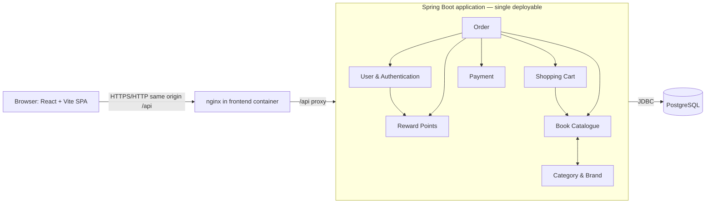
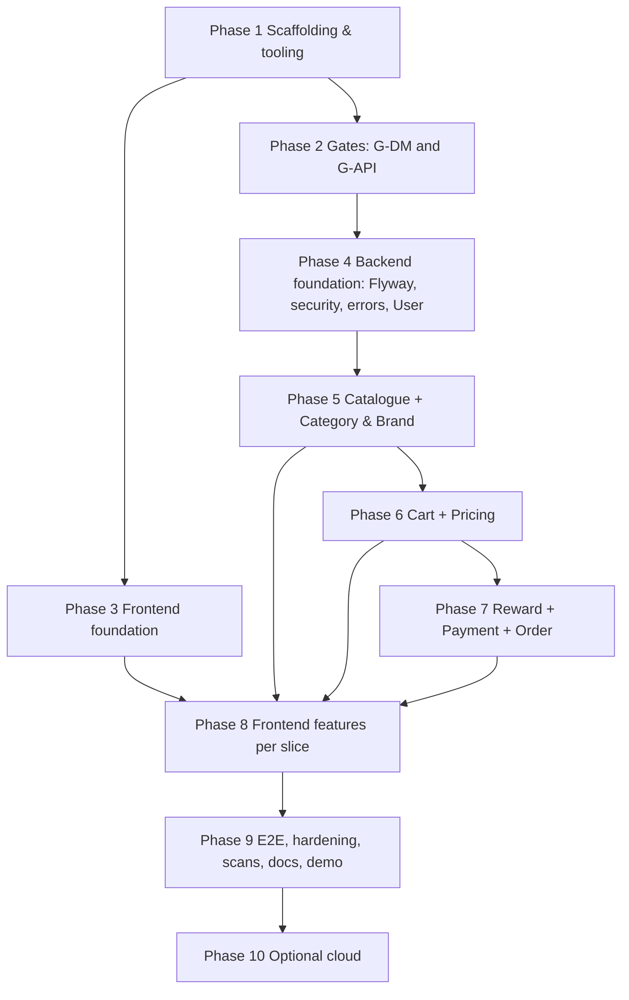

# Implementation Plan: BookyGeek — Complete Online Bookstore Platform

**Branch**: `001-bookygeek-platform` | **Date**: 2026-11-12 | **Spec**: [spec.md](spec.md)

**Input**: Feature specification `/specs/001-bookygeek-platform/spec.md` (Clarify phase complete, Revisions 1–4) and
constitution `.specify/memory/constitution.md` v2.0.0 (amended by AMD-001).

**Companion artifacts**: [research.md](research.md) (PL-01..PL-10 decisions) · [data-model.md](data-model.md) (gate G-DM) ·
[contracts/api-contract-outline.md](contracts/api-contract-outline.md) (gate G-API) · [quickstart.md](quickstart.md) ·
[amendments/AMD-001-spring-boot-4.md](amendments/AMD-001-spring-boot-4.md) (approved and applied stack amendment)

**Phase status**: Planning only. No application code, migration scripts or endpoints exist or are produced by this
phase. `tasks.md` is **not** created (next command: `/speckit-tasks`, now permitted because G-PLAN is approved; run only on the owner's instruction).

## Summary

BookyGeek is a customer-only online bookstore delivering all 12 capstone journeys (browse → basket → checkout with
dummy payment and reward points → confirmation → order history, Buy Again, 48-hour cancellation). It is built as the
**approved modular monolith**: one React + Vite SPA, one Spring Boot application with seven in-process logical modules
(Controller → Service → Repository → Entity, DTOs at the boundary), and one PostgreSQL database managed by Flyway.

Technical approach (all within approved decisions): contract-first REST API (`api/openapi.yaml`, hand-written,
validated in Swagger Editor); Spring Security with a JWT carried in an HttpOnly cookie; server-authoritative pricing
and stock handling with pessimistic row locks; deterministic dummy payment values; vertical-slice delivery with two
mandatory owner approval gates (data model, OpenAPI) before backend implementation; Docker Compose for the local
stack; cloud deployment optional.

## Technical Context

**Language/Version**: Java 21 (backend); JavaScript ES2022+ (frontend, no TypeScript)

**Primary Dependencies**: *Backend* — Spring Boot 4.x (**per approved amendment AMD-001**: constitution v2.0.0 fixes the
4.x generation because no 3.x line has active OSS support; the exact latest stable 4.x release is pinned at scaffolding,
see [AMD-001](amendments/AMD-001-spring-boot-4.md) and R-01), Spring Web, Spring Data JPA/Hibernate, PostgreSQL JDBC driver, Spring Security
(+ OAuth2 Resource Server for JWT), Bean Validation, Flyway. *Frontend* — React, Vite, React Router, Axios, plain CSS.
Exact versions: latest stable at scaffolding, pinned in `pom.xml` / `package.json`, lock files committed.

**Storage**: PostgreSQL (single database, single schema `public`), Flyway-managed, Hibernate `ddl-auto=validate`

**Testing**: JUnit 5, Mockito, Spring Boot Test (backend, integration tests against a real PostgreSQL service
defined in Docker Compose); Vitest + React Testing Library (frontend); Playwright (end-to-end)

**Target Platform**: Linux containers (Docker Compose) on a developer machine; browsers: latest Chrome, Edge, Firefox

**Project Type**: Web application (SPA frontend + REST backend + database)

**Performance Goals**: typical API response < 1 s and initial front-end load < 3 s in normal local conditions
(development targets, NFR-PERF-01/02; no production SLA)

**Constraints**: modular monolith only (no microservices, gateway, broker, per-module DB); contract-first API; dummy
payments only (no PAN/CVV persisted or logged); dark theme only; desktop/tablet/mobile layouts; services bound to
localhost on the host; secrets only from environment

**Scale/Scope**: single-developer capstone; ≈ 60 seeded books, 19 leaf categories, 15 screens, 29 endpoints (outline),
7 backend modules, 11 tables (RP-1 owner-approved: ledger kept). No `NEEDS CLARIFICATION` remains (see research.md).

## Constitution Check

*GATE: passed before Phase 0 research; re-checked after Phase 1 design (below). Governance: Principles marked
NON-NEGOTIABLE (I, IX) cannot be waived per feature.*

| # | Principle | Gate | Pre-research | Post-design evidence |
|---|---|---|---|---|
| I | Capstone fidelity (NON-NEGOTIABLE) | All 12 journeys + 4 payment methods mapped to scope and to an E2E test | PASS | quickstart E2E-01..08 map to spec §6.1; plan Phase 9 requires all pass |
| II | Monolithic modular layered | 3 runtime parts, 7 modules, layers, no cross-repository access, no distributed machinery, justified abstractions | PASS | See "Architecture". Services are concrete classes (no speculative interfaces). One justified bidirectional service pair recorded in Complexity Tracking |
| III | Approved stack; additions approved | Each addition proposed in writing with purpose/alternatives; versions actively maintained | **PASS** — the former conflict (fixed "Spring Boot 3.x" with no actively supported line) is resolved by approved AMD-001 (constitution v2.0.0, Spring Boot 4.x); additions are covered by approval of this plan (G-PLAN) | "Principle III Additions Register" below (PL-09); [AMD-001](amendments/AMD-001-spring-boot-4.md) |
| IV | Contract-first API | OpenAPI approved before endpoints; consistent error schema; per-endpoint test | PASS (planned) | Gate G-API, `contracts/api-contract-outline.md`, traceability matrix |
| V | Data integrity, reviewed DB design | Data model approved before backend; PK/FK/CHECK; transactional multi-record ops; reproducible schema/seed | PASS (planned) | Gate G-DM, `data-model.md`, transactions in "Backend design", Flyway |
| VI | Frontend quality | Documented structure, shared Axios, loading/error states, client validation, responsive, tokens | PASS | "Frontend design" |
| VII | Test-verified delivery | Rule-by-rule tests, integration against PostgreSQL, E2E journeys | PASS | "Testing strategy" |
| VIII | Secure by default | Env secrets, adaptive hash, server auth, no PAN/CVV, parameterised access, generic errors, localhost binding, CORS allowlist, dependency scanning | PASS with one recorded exception (container-internal bind) | "Security design", Complexity Tracking |
| IX | Spec-driven workflow (NON-NEGOTIABLE) | Order: … plan → tasks → implement; no silent changes | PASS | Plan stops here; revisions follow Principle IX |

**Result**: PASS. The one earlier gate item — the Principle III stack conflict (Spring Boot 3.x vs. active support) — was
handled by amendment AMD-001, approved and applied on 2026-11-12 (constitution v2.0.0). No violations remain.

### Principle III Additions Register (PL-09)

Written proposals required by constitution Principle III. "Approved" (OD-n) = already owner-approved in the spec
(§5.1, Clarifications). "Approved (G-PLAN, 2026-11-12)" = required by an approved decision or by Constitution/security
text but not previously named by the owner; approved by the owner together with this plan. The optional GitHub Actions
workflow stays optional and needs separate approval if used. Nothing below changes architecture or modules.

| Addition | Purpose | Alternatives considered | Status |
|---|---|---|---|
| Spring Security + `spring-boot-starter-oauth2-resource-server` (Nimbus JWT) | Authentication, JWT validation, CSRF, password-encoder, method/route protection (OD-1) | Hand-written filters (insecure, more code); JJWT third-party lib (extra dependency); server sessions (OD-1 chose JWT) | Approved (OD-1); resource-server starter = part of the same family, confirmed by plan approval |
| Flyway (`flyway-core`, `flyway-database-postgresql`) | Versioned SQL migrations, Hibernate validate (OD-3) | Liquibase (heavier XML/YAML); JPA auto-DDL (prohibited by NFR-DAT-05) | Approved (OD-3) |
| JUnit 5, Mockito, Spring Boot Test; Vitest, React Testing Library; Playwright | Backend/frontend/E2E tests (OD-8) | TestNG, Jest, Cypress | Approved (OD-8) |
| Swagger Editor (developer tool, not shipped) | Author/validate `openapi.yaml` (OD-10) | Generated spec via springdoc (contradicts contract-first) | Approved (OD-10) |
| Docker Compose | Local stack (OD-11) | Manual installs; Kubernetes (overkill) | Approved (OD-11) |
| **Bean Validation** (`spring-boot-starter-validation`) | Server-side validation of DTOs with annotations mirroring the contract (Principle IV/VIII; example named in Principle III) | Hand-written validators (more code, higher defect risk) | Approved (G-PLAN, 2026-11-12) |
| **PostgreSQL JDBC driver** | Mandatory to reach the approved PostgreSQL database | none (required) | Approved (G-PLAN, 2026-11-12) (technical necessity) |
| **jsdom, @testing-library/jest-dom, @testing-library/user-event** (devDependencies) | Companions required to run Vitest + RTL component tests (OD-8) | `happy-dom` (less complete) | Approved (G-PLAN, 2026-11-12) (OD-8 companions) |
| **nginx** (static hosting + `/api` reverse-proxy inside the frontend container) | Serve the Vite build and give same-origin cookie auth in Compose/cloud | Spring serving static files (merges front into back, violates "one React frontend" runtime separation); separate CORS cross-origin setup (weaker cookie/CSRF story) | Approved (G-PLAN, 2026-11-12) |
| **OWASP Dependency-Check Maven plugin, `npm audit`, GitHub Dependabot** | Dependency vulnerability scanning (NFR-SEC-07, security rules); Mend if owner has access (PL-08) | Mend only (account dependency), Snyk | Approved (G-PLAN, 2026-11-12) |
| **Red Hat UBI container images** (`registry.redhat.io`) | Security-policy-mandated image source for Dockerfiles | Docker Hub official images (non-compliant) | Approved (G-PLAN, 2026-11-12) (policy-driven) |
| GitHub Actions workflow (build + test + scans on PR) — *optional* | Automate Quality Gates 1–3 and SAST/dependency checks | Manual runs (permitted fallback) | **Optional; needs approval if used** |
| `swagger-request-validator` — *optional, not planned* | Automatic response-vs-OpenAPI check in tests | Hand-written contract assertions (chosen) | Not adopted |

**Explicitly not adopted** (so no approval needed): Lombok, springdoc-openapi, Testcontainers (a Compose
`postgres-test` service is used instead), MapStruct, Redux/Zustand, TypeScript, CSS frameworks/UI kits,
Spring Boot Actuator, Redis/caching, Elasticsearch/full-text search, any message broker.

**Constitution technology-principle updates**: The spec (§5.1) states the constitution text apart from the stack line
remains unchanged and the additions are recorded here, so this register is the authoritative record of the approved
additions. The Spring Boot generation change (3.x → 4.x) was applied as the MAJOR amendment
[AMD-001](amendments/AMD-001-spring-boot-4.md) (constitution v2.0.0, 2026-11-12). The earlier optional 1.0.1 PATCH idea
(listing the additions inside Principle III) was **not** actioned; the owner may request it separately.

## Planning decisions (PL-01 … PL-10) — summary

Full rationale and alternatives are in [research.md](research.md).

| ID | Decision (final for implementation) |
|---|---|
| PL-01 | Guest basket in `localStorage` as `{bookId, quantity}`; on login `POST /basket/merge` **sums quantities per book, caps at min(10, stock)**, skips unavailable books, returns an adjustment report; client clears storage only after success. Guest pricing via public `POST /basket/preview`. |
| PL-02 | `NUMERIC(12,2)`/`BigDecimal`/decimal-string API. Tax = 5% of subtotal rounded **HALF_UP once per order**. Delivery 40.00 if any physical book else 0. Reward cap = `min(balance, floor(50% × (subtotal+tax+delivery)))` (fraction rounded **down**), whole points only. |
| PL-03 | JWT HS256, **60-minute** absolute lifetime, no refresh token; in **HttpOnly SameSite=Strict (Secure by env) cookie**, SPA never sees it; CSRF double-submit enabled; **logout bumps `customer.token_version`** and expires the cookie; PBKDF2-SHA256 (salted, delegating encoder) password hashing; 401 → redirect to login with `returnTo`. |
| PL-04 | **"Brands" list in the left sidebar** under the category tree; also the "Published by" link on the detail page; `?brand=` query parameter; brand = `book.publisher`. |
| PL-05 | Two-level category tree (Fiction / Non-Fiction → 19 leaf categories of the wireframe); formats PAPERBACK/HARDCOVER/EBOOK; languages English/Hindi/French/Spanish; four price bands; India states list as classpath reference; ≈ 60 reproducible seed books; no seeded customers. |
| PL-06 | Success card `4111-1111-1111-1111`; **decline card `4000-0000-0000-0002`**; UPI format `name@handle`, success `demo@upi`, **decline `failure@upi`**; COD no details; nothing about the card is persisted. |
| PL-07 | Relevance = title-match rank, then availability, then title; no-search default = available first, newest first. Stock concurrency = **pessimistic `SELECT … FOR UPDATE` on book rows in ascending id order**, DB CHECKs as backstop; double-submit protection via `Idempotency-Key`. |
| PL-08 | OWASP Dependency-Check (Maven), `npm audit`, Dependabot; Mend additionally if available; reports attached to delivery. |
| PL-09 | Written proposals in the Additions Register above; no edit to the constitution by this plan. |
| PL-10 | Gates G-DM and G-API (Gate Register below) block all backend implementation; sequenced in Phase 2. |

## Architecture and module responsibilities



| Module (package) | Responsibilities | Tables owned | Calls (in-process services) |
|---|---|---|---|
| **User & Authentication** (`user`) | Register, login, logout, JWT issue/validation support, current customer, saved addresses, states reference | `customer`, `address` | Reward (create account on registration) |
| **Book Catalogue** (`catalogue`) | Book list/search/filter/sort/paging, relevance, details, availability, delivery date, related books, publisher list, filter options | `book`, `book_category` | Category & Brand (`subtreeIds`) |
| **Category & Brand** (`category`) | Category tree, subtree ids, breadcrumb; brand list endpoint (`/brands`) | `category` | Catalogue (`listPublishers`) |
| **Shopping Cart** (`cart`) | Customer basket CRUD, guest preview, merge, limits (10/stock), **`PricingService`** (single place for all money arithmetic) | `basket_item` | Catalogue |
| **Order** (`order`) | Checkout quote, place order (transaction orchestrator), order history/detail, cancellation, Buy Again, recommendations | `orders`, `order_item` | Cart, Catalogue, Payment, Reward, User |
| **Payment** (`payment`) | Simulated card/UPI/COD processing, payment records and states, refund/cancel records | `payment` | — |
| **Reward Points** (`reward`) | Balance, redeem limits (balance, 50% cap), restore, ledger (RP-1 approved: ledger kept) | `reward_account`, `reward_transaction` | — |

Rules (enforced by review and an automated package-dependency test using plain JUnit reflection — no extra library):
- Layers inside each module: `controller` → `service` → `repository` → `entity`, with `dto` at the boundary. Controllers
  never touch repositories; entities never leave services (mapped to records/DTOs).
- A module reads another module's data only through that module's **public `*Service`**; repositories and entities are
  package-private to their module.
- `common` package: error model + `@RestControllerAdvice`, security config, clock, configuration properties, cross-cutting
  utilities. It holds no business rules.
- No service interfaces, no generic base repositories/services, no factory classes: single implementations only
  (Principle II abstraction rule).

## Project Structure

### Documentation (this feature)

```text
specs/001-bookygeek-platform/
├── plan.md                             # This file
├── research.md                         # Phase 0 — PL-01..PL-10 and technical decisions
├── data-model.md                       # Phase 1 — gate G-DM (approved; RP-1, RP-2 owner-approved)
├── amendments/
│   └── AMD-001-spring-boot-4.md        # Approved and applied constitution/spec amendment
├── quickstart.md                       # Phase 1 — run/validation guide
├── contracts/
│   └── api-contract-outline.md         # Phase 1 — gate G-API input (openapi.yaml is an implementation-phase artifact)
├── checklists/requirements.md          # existing
└── tasks.md                            # NOT created here (/speckit-tasks)
```

### Source code (repository root — created in implementation Phase 1)

```text
bookygeek/
├── api/
│   ├── openapi.yaml                    # contract (gate G-API)
│   └── TRACEABILITY.md                 # operationId ↔ controller ↔ test
├── backend/
│   ├── pom.xml                         # versions pinned; Dependency-Check plugin
│   ├── Dockerfile                      # registry.redhat.io UBI images, non-root
│   └── src/
│       ├── main/java/com/bookygeek/
│       │   ├── BookygeekApplication.java
│       │   ├── common/                 # config, security, error (ApiError, handler), time (Clock), props
│       │   ├── user/                   # controller / service / repository / entity / dto
│       │   ├── catalogue/
│       │   ├── category/
│       │   ├── cart/                   # includes PricingService
│       │   ├── order/
│       │   ├── payment/
│       │   └── reward/
│       ├── main/resources/
│       │   ├── application.yml, application-dev.yml, application-test.yml, application-prod.yml
│       │   ├── db/migration/           # Flyway V1__… schema scripts (after G-DM approval)
│       │   ├── db/seed/                # reproducible categories + books (dev/test only)
│       │   └── reference/states.json
│       └── test/java/com/bookygeek/    # unit/, integration/, contract/, architecture/ per module
├── frontend/
│   ├── package.json, package-lock.json, vite.config.js, index.html
│   ├── Dockerfile, nginx.conf          # UBI nginx, /api proxy, non-root, read-only fs
│   ├── public/covers/                  # generated placeholder covers
│   └── src/
│       ├── main.jsx, App.jsx, routes.jsx
│       ├── api/                        # axiosClient.js (single shared instance) + per-resource modules
│       ├── context/                    # AuthContext, BasketContext
│       ├── hooks/                      # useBasket, useCatalogueQuery, useAsync …
│       ├── components/                 # common/ (Button, Field, Modal, Spinner, ErrorMessage, EmptyState),
│       │                               # layout/ (Header, Sidebar, PageShell), book/ (BookCard, BookCardCompact)
│       ├── pages/                      # CataloguePage, BookDetailPage, BasketPage, LoginPage, RegisterPage,
│       │                               # CheckoutPage, PaymentPage, PaymentConfirmedPage, PurchaseConfirmedPage,
│       │                               # OrdersPage, OrderDetailPage, AddressesPage, NotFoundPage
│       ├── utils/                      # money, date (Mon, 21 Jul), validators, storage
│       ├── styles/                     # tokens.css, base.css, per-component CSS
│       └── test/                       # setup + tests co-located as *.test.jsx
├── e2e/                                # Playwright project (own package.json)
├── docker-compose.yml                  # frontend, backend, postgres; profile "test": postgres-test
├── .env.example                        # names + safe placeholders only
├── .gitignore                          # .env, target/, node_modules/, dist/, reports …
└── README.md                           # setup, run, test, deploy (kept current each PR)
```

**Structure Decision**: Web application with separate `backend/` and `frontend/` projects in one repository
(monorepo), plus `api/` (contract) and `e2e/` (journey tests). No other runtime parts exist.

## Frontend design

- **Stack**: React, Vite, React Router, Axios, plain CSS only. Function components + hooks. Naming: PascalCase components
  and files, camelCase functions/variables, one component per file with a same-named CSS file.
- **Single API gateway for the SPA**: `api/axiosClient.js` is the only place that creates the Axios instance
  (`baseURL: '/api/v1'`, `withCredentials`, XSRF cookie/header names, 10 s timeout, response interceptor mapping
  `ApiError` to a normalised error and handling 401). No other file imports Axios.
- **State**: `AuthContext` and `BasketContext` only; `useBasket()` hides guest-vs-customer storage; filters in URL
  query; checkout draft in `sessionStorage`; card data stays in component state, never persisted or logged.
- **Routing**: routes listed in research R-22; `ProtectedRoute` redirects to `/login?returnTo=` (A-12); not-found route.
- **Every data view** uses `useAsync` (loading → data | error with Retry) and shows `Spinner`, `ErrorMessage`,
  `EmptyState` (Principle VI, NFR-FE-01). Every form validates client-side with shared `validators.js` that mirrors the
  contract rules (password 8–64 + letter + digit, 10-digit phone, 6-digit PIN, card/UPI formats, expiry) and also renders
  server `fieldErrors`.
- **Design system**: `tokens.css` defines the dark palette, spacing, typography scale and the 640/1024 px breakpoints
  (DS-01..06, DS-11); shared Button/Field/Card components (DS-03..05, DS-09). Header contains only functional items
  (brand "BookyGeek", My Orders, basket + badge, account menu with Log out, menu icon toggling sidebar) (DS-07, DS-12).
  Responsive: desktop = wireframe composition; tablet = two-column / collapsible sidebar; mobile = single column with
  sidebar and filter row behind toggles (RSP-01..05).
- **Screen map**: SCR-04 Catalogue (sidebar tree + Brands, filter row, sort, 12/page, Recommended for You when
  non-empty); SCR-05 detail (breadcrumb, covers, Add to Cart, Related Reads); SCR-06 basket + recommendations;
  SCR-07 checkout (basket panel, address form/saved addresses, summary, reward area below summary); SCR-08 payment dialog;
  SCR-12 payment confirmation; SCR-09 purchase confirmation; SCR-10/11 orders; SCR-02/03 login/register; SCR-13 states.
- **Wireframe fidelity**: the 5 reference PNGs are the visual acceptance baseline (SC-003); removed elements (wishlist,
  ratings, reviews, writer, coupon, wallet, Bestsellers/New Launches, "Book Worm") are verified absent by a UI string test.
  Reviews, ratings and the writer section are re-admitted by AMD-002.
- **Accessibility**: labelled inputs, keyboard focus order and visible focus, `alt` on covers, contrast-checked tokens,
  `aria-live` for error/success messages (NFR-ACC-01).

## Backend design

- **Layers per module**: `controller` (request mapping, `@Valid`, DTO↔service calls only) → `service` (business rules,
  `@Transactional` boundaries) → `repository` (Spring Data JPA, parameterised JPQL/Specifications) → `entity`.
  DTOs are Java records. Constructor injection. Centralised `@RestControllerAdvice` maps exceptions to the single
  `ApiError`; unknown exceptions → generic 500 + server-side log only.
- **Clock**: an injected `java.time.Clock` bean (Asia/Kolkata, configurable); tests substitute a fixed clock
  (delivery dates, 48-hour boundary).
- **Pricing**: `PricingService` (Cart) is the single implementation of the rules in PL-02; guest preview, basket, quote and
  place-order all call it.
- **Order placement (one transaction)**: lock book rows (ascending id) → lock reward account → revalidate basket lines,
  stock and `expectedPayableTotal` → process simulated payment (declined ⇒ throw) → insert order, items, payment
  (+ `REDEEM` ledger row only when `points_redeemed > 0`) → decrement physical stock →
  deduct points (only when `points_redeemed > 0`) → clear basket. Declined attempts persist only a
  `FAILED` payment row via `REQUIRES_NEW`. Idempotency via `(customer_id, idempotency_key)` unique constraint.
- **Cancellation (one transaction)**: load own order `FOR UPDATE`; reject non-PLACED or `now − placed_at ≥ 48h`; restore
  stock (locked ascending), restore points and insert a `RESTORE` ledger row only when `points_redeemed > 0`, update payment (PAID→REFUNDED, PENDING→CANCELLED), status→CANCELLED.
- **Buy Again** and **recommendations** live in Order: Buy Again calls Cart's add logic per line (current price/stock,
  caps) and returns a report; recommendations = leaf categories of previously ordered books → other listed, available
  books in those categories, excluding basket items, limited to 12, stable ordering.
- **Validation**: Bean Validation on DTOs + service-level business checks; unknown/foreign ids → 404.
- **Config**: `@ConfigurationProperties` for JWT, rewards (`initial-points`, `cap-percent`), pricing (`tax-rate`,
  `delivery-charge`), catalogue (`page-size`, `delivery-days`), CORS, cookie flags. Per-environment profiles; secrets only
  from environment variables.
- **Logging**: JSON structured console logs; request/response bodies never logged; payment DTO `toString` masked.

## Database ownership and data design approach

Detailed in [data-model.md](data-model.md) (**gate G-DM**). Summary: 11 tables (RP-1 and RP-2 owner-approved); surrogate identity keys; FKs everywhere;
CHECK constraints for status/format/quantity/stock/balance/phone/PIN; unique case-normalised e-mail; documented duplicates
limited to the order address snapshot, `unit_price` and the module-boundary `customer_id` columns on `reward_transaction`/`payment`; no coupon/wallet/wishlist/review/author/genre/brand/role tables.
Schema is produced only by Flyway `V1__…` scripts written **after** G-DM approval; seed data is a separate Flyway location
(`db/seed`) active in `dev`/`test`; `prod` runs schema migrations only. Hibernate `ddl-auto=validate`. Table ownership per
module (Principle II); no cross-module repository access.

## API contract strategy

See [contracts/api-contract-outline.md](contracts/api-contract-outline.md): hand-written `api/openapi.yaml`, `/api/v1`,
one `ApiError` schema, fixed-size paging (12), decimal-string money, `operationId` on every operation, traceability matrix
`api/TRACEABILITY.md`. Flow: outline (this plan) → author YAML → validate in Swagger Editor → owner approval (**G-API**) →
controllers implemented to match → any deviation updates the YAML in the same PR (Principle IV).

## Authentication and security design

| Concern | Design |
|---|---|
| AuthN | Spring Security stateless filter chain; JWT (HS256, 60 min) from `BG_AUTH` HttpOnly cookie; `tv` claim checked against `customer.token_version` |
| AuthZ | Single role (customer). Public routes: catalogue/categories/brands/books/related/filter-options/states/basket-preview/register/login. Everything else authenticated. Ownership enforced by scoping every query with the JWT subject; foreign ids → 404 |
| Passwords | PBKDF2-HMAC-SHA256 via `DelegatingPasswordEncoder`, per-user salt; no plaintext/MD5/SHA-1; dummy-hash on unknown e-mail; generic login failure message |
| CSRF/CORS | CSRF on with cookie-to-header token; `SameSite=Strict`; same-origin via proxy; CORS allowlist from env, empty default |
| Input | Bean Validation + service rules; parameterised JPA only; wildcard-escaped `ILIKE`; React escapes output (no `dangerouslySetInnerHTML`) |
| Payments | Simulated only; PAN/CVV/expiry/UPI ID never stored/logged; masked `toString`; body logging off |
| Errors | One generic `ApiError`; stack traces server-side only |
| Headers | `X-Content-Type-Options`, `Referrer-Policy`, `Content-Security-Policy` (self only) and `X-Frame-Options: DENY` set by Spring Security/nginx; HSTS when TLS terminates |
| Secrets | `.env` (git-ignored) / host secret store; `.env.example` placeholders; startup fails fast if `JWT_SECRET` is missing or short |
| Network | Host ports bound to `127.0.0.1`; TLS 1.2+ with valid certificates for any non-local deployment; no certificate-validation bypass |
| Containers | UBI images from `registry.redhat.io`, non-root user, read-only root FS + tmpfs, `cap_drop: ALL`, `no-new-privileges`, healthchecks, resource limits; image scan (e.g., `podman/trivy` or registry scan) before delivery |
| Dependencies | Latest stable versions; Dependency-Check + `npm audit` + Dependabot; critical/high fixed or documented |
| Monitoring | Auth failures and 5xx logged at WARN/ERROR with structured fields (no PII beyond customer id) |

## Frontend–backend integration

- Browser always calls **relative** `/api/v1/...`. In Compose, nginx serves `dist/` and proxies `/api/` to
  `backend:8080`; in development, Vite's proxy forwards `/api` to `127.0.0.1:8080`. Same origin ⇒ cookie auth works with
  `SameSite=Strict` and no CORS in normal operation.
- Contract is the integration agreement: front-end API modules are written from `openapi.yaml` and fixtures in front-end
  tests use contract example bodies.
- Error handling: Axios interceptor normalises `ApiError`; pages show `message`/`fieldErrors`; 401 redirects with
  `returnTo`; network failure shows retry.
- Guest → customer: after `POST /auth/login`, `BasketContext` calls `POST /basket/merge` with the stored guest lines, shows
  the report, clears storage and reloads the server basket; then navigates to `returnTo`.
- Dates/money: server sends ISO dates and decimal strings; `utils/date.js` formats "Mon, 21 Jul"; `utils/money.js` formats
  `₹1,090.00` (display only; never computes).

## Testing strategy

| Level | Tools | Scope |
|---|---|---|
| Backend unit | JUnit 5 + Mockito | `PricingService` (rounding, tax, delivery, eBook-only), reward cap/boundary, delivery-date rule (fixed clock), cancellation window 47:59:59 vs 48:00:00 (incl. COD), Buy Again report, guest-merge rule, relevance ranking, payment simulator values, validators |
| Backend integration | Spring Boot Test (`MockMvc`/`@SpringBootTest`) + real PostgreSQL (`postgres-test` Compose service), Flyway-migrated | Every endpoint: status + body shape vs contract; DB persistence assertions; transaction rollback on injected failure; concurrency (two threads, last unit); double-submit `Idempotency-Key`; ownership (other customer → 404); unauthenticated/tampered-JWT → 401; error shape; no PAN/CVV in tables/logs; Flyway-only schema passes Hibernate validate |
| Architecture rules | Plain JUnit (reflection/classpath scan) | Controllers don't depend on repositories; modules don't import other modules' repositories/entities |
| Frontend | Vitest + React Testing Library | Components (BookCard, Header, Sidebar), forms and validators, basket (guest and customer), checkout/payment flows, unavailable/empty/error/loading states, banned-string check ("Book Worm", Wishlist, Coupon, Wallet…) |
| End-to-end | Playwright (`e2e/`) against the Compose stack | E2E-01..08 in quickstart = the 12 journeys; Chrome, Edge, Firefox projects; three viewport sizes for layout smoke checks; keyboard-only run |
| Non-functional | Manual checklist + scripts | Response-time and load-time spot checks, contrast/alt/labels, wireframe comparison per supplied screen (SC-003), dependency scan reports |

Test data: reproducible seed catalogue plus accounts registered by tests (no committed credentials); documented dummy
payment values (quickstart §5). Rule→test mapping table is maintained in `api/TRACEABILITY.md` and
`docs/test-matrix.md` (NFR-TST-01, SC-007/008). Quality gate: `mvn clean verify`, `npm test`, `npm run build`, Playwright,
scans — all green before merge.

## Local development and Docker Compose

- `docker-compose.yml` services: **postgres** (`registry.redhat.io/rhel9/postgresql-<latest>`, named volume, env
  credentials, healthcheck), **backend** (multi-stage build; depends_on postgres healthy; runs as non-root; Flyway migrates
  on start; profile `dev` seeds), **frontend** (multi-stage Node build → UBI nginx; proxies `/api`), and, under profile
  `test`, **postgres-test** (port 5433, tmpfs). Published ports: `127.0.0.1:3000`, `127.0.0.1:8080`,
  `127.0.0.1:5432` only.
- Native development: `mvn spring-boot:run` (binds `127.0.0.1`) + `npm run dev` (Vite on `127.0.0.1:5173`).
- `.env.example` documents variables (quickstart §2). `README.md` carries setup/run/test/deploy steps and the dummy test
  values, updated in every PR (NFR-LOC-02/04, NFR-MNT-02).
- Prerequisite to document: Red Hat registry login for pulling UBI images.

## Optional cloud deployment approach

Never mandatory (OD-11, NFR-LOC-03). Only if a free-tier container host and a PostgreSQL service are available: the same
two images, configuration from host secrets, TLS 1.2+ termination with a valid certificate, `COOKIE_SECURE=true`,
`prod` profile (no seed, Flyway schema only), CORS allowlist still empty (same origin via the frontend's proxy). The design
is already 12-factor (env config, stateless backend, logs to stdout), so deployment needs no code change. Decision of host
is deferred until access exists; if none, this step is recorded as "not performed" without affecting completion.

## Implementation phases and dependencies



| Phase | Content | Depends on | Exit criteria |
|---|---|---|---|
| 1 Scaffolding & tooling | Repo layout, `.gitignore`, `.env.example`, Maven/Vite projects with pinned latest-stable versions and lock files, empty Dockerfiles/Compose, README skeleton, scan tooling. **Backend (Maven/Spring Boot 4.x) scaffolding pins the newest patch of the supported 4.x line and verifies starters against the official migration guide (AMD-001, approved); the front-end part is unaffected.** **No entities, tables or endpoints.** | Plan approved, `tasks.md` | `mvn clean install` and `npm run build` pass on empty apps; Compose starts empty stack |
| 2 Gates | **G-DM** (approved 2026-11-12): `data-model.md`, RP-1 and RP-2 owner-approved. **G-API**: author `api/openapi.yaml` from the outline, validate in Swagger Editor, owner approves. Both recorded in the Gate Register | Plan; runs parallel to 3 | Both approvals recorded |
| 3 Frontend foundation | Tokens/base CSS, layout (Header, Sidebar, PageShell), common components, Axios client, contexts, router, validators, utils, test setup. Uses fixture data only | Phase 1 | Component tests pass; static screens match wireframes |
| 4 Backend foundation | Flyway V1 schema + seed from approved model, `ApiError` handling, Clock, config properties, Spring Security + JWT + CSRF, User module (register/login/logout/me, addresses, states), Reward account creation | **G-DM and G-API approved** | Auth endpoints pass contract tests; Flyway-only build passes validate |
| 5 Catalogue + Category & Brand | Categories, brands, book list/filter/sort/search/relevance/paging, detail, related, filter-options, delivery date | Phase 4 | Contract tests + filter/sort/page integration tests |
| 6 Cart + Pricing | `PricingService`, customer basket CRUD, preview, merge, limits | Phase 5 | Pricing/limit/merge unit + integration tests |
| 7 Reward + Payment + Order | Rewards API, quote, payment simulator, place order (atomic, idempotent, locked), orders, cancellation, Buy Again, recommendations | Phase 6 | Boundary, concurrency, rollback, state-matrix tests |
| 8 Frontend features | Pages wired to the real API slice by slice (auth → catalogue → detail → basket → checkout/payment/confirmations → orders/addresses); responsive and a11y passes | Phase 3 + matching backend phase | RTL flow tests pass per slice |
| 9 Verification & delivery | Playwright E2E-01..08 (3 browsers), NFR checks, wireframe review, dependency scans, docs/README/API docs, demo video, PR(s) | Phases 7, 8 | Success criteria SC-001..SC-010 |
| 10 Optional cloud | Deploy if free-tier access exists | Phase 9 | Optional |

Parallelism: front-end foundation (3) and gate work (2) proceed together; front-end slices wait only for the matching
API slice. Work is delivered through feature branches and Pull Requests, each updating docs and API docs.

### Gate Register

| Gate | Artifact | Required before | Status | Approved by / date |
|---|---|---|---|---|
| G-PLAN | This plan (+ Additions Register) | `/speckit-tasks` | **Approved** | Project owner, 2026-11-12 (includes the Principle III additions; optional GitHub Actions remains separately optional) |
| G-AMD-001 | [`amendments/AMD-001-spring-boot-4.md`](amendments/AMD-001-spring-boot-4.md) — Spring Boot 3.x → 4.x | Backend scaffolding (Phase 1 backend part) and any pinned Boot version | **Approved** | Project owner, 2026-11-12 (Option A, MAJOR 2.0.0; constitution and spec updated) |
| G-DM | `data-model.md` (RP-1 keep `reward_transaction` and RP-2 no basket header: **OWNER APPROVED**) | Any backend entity/migration/service code (Phase 4+) | **APPROVED** | Project owner, 2026-11-12 (RP-1, RP-2 and the `orders` 50% reward-cap CHECK included) |
| G-API | `api/openapi.yaml` validated (command-line validators; hosted Swagger Editor not run) | Any controller (Phase 4+) | **APPROVED** | Project owner, 2026-11-14 (after three review corrections to the contract; see `contracts/api-contract-outline.md` §5) |

## Risks and genuine blockers

**No genuine blocker remains for the planning phase.** R-01 (Spring Boot generation) was resolved by approved AMD-001.
Items to watch:

| ID | Risk / dependency | Mitigation |
|---|---|---|
| R-01 | **Resolved by AMD-001 (approved 2026-11-12).** Residual risk: Spring Boot 4.x is a newer major generation (renamed starters, Spring Security 7, Jackson 3, `@MockitoBean`); the exact 4.x release and the support status are re-verified at scaffolding | Pin the newest patch of the supported 4.x line in Phase 1; check the official migration guide; keep the "empty apps build" exit criterion; write Spring Security config early in Phase 4 |
| R-02 | Owner sign-off on the Principle III additions (Bean Validation, JDBC driver, test companions, nginx, scanners, UBI images) | **Resolved**: approved with G-PLAN on 2026-11-12 |
| R-03 | Red Hat registry login needed to pull UBI images | Documented prerequisite; fallback is an owner-approved exception, not silently Docker Hub |
| R-04 | Exact UBI image tags / PostgreSQL major in `registry.redhat.io` not verifiable offline | Verify and pin at Phase 1 |
| R-05 | Mend access unknown | PL-08 baseline scanners used regardless |
| R-06 | Wireframe PNGs are the visual baseline; dummy cover art must be created | Generated SVG placeholders, SC-003 review |
| R-07 | Cookie-based JWT plus CSRF is slightly more work than a bearer token | Chosen for security policy; Axios XSRF config + one integration test cover it |

## Complexity Tracking

| Violation / deviation | Why needed | Simpler alternative rejected because |
|---|---|---|
| Container-internal listeners accept connections on the container network interface (not literally `127.0.0.1`) | Compose services reach each other over the private bridge network; `127.0.0.1` inside a container is unreachable from another container. Host exposure is limited by publishing only to `127.0.0.1:<port>`; Postgres/backend need not be published at all in `prod` | Binding to loopback inside containers would make the stack unusable; running one container for everything violates the three-part runtime layout |
| Catalogue ↔ Category & Brand call each other's services (`subtreeIds`, `listPublishers`) | Category tree is owned by Category & Brand while `/brands` derives from the book's publisher owned by Catalogue (brand = publisher, CL-02) | A brand table duplicates data (Principle V); merging the modules contradicts the seven approved modules; each call is a single named method, no repository sharing |
| Order module hosts Buy Again and recommendations | They need order history plus Cart/Catalogue; placing them in Catalogue/Cart would create module cycles | Separate recommendation module is a new module (not allowed, CL-10.31) |

## Post-design Constitution Check (re-evaluation)

All principles re-evaluated after Phase 1: **PASS**. The earlier Principle III conflict ("Spring Boot 3.x" vs. the
maintenance rule) is resolved by approved AMD-001 (constitution v2.0.0). G-PLAN, G-AMD-001 and G-DM are approved; the only
gate G-API was approved on 2026-11-14 after `api/openapi.yaml` was authored and validated; no gate remains open. Scope,
architecture, the seven modules and all clarified requirements are unchanged; the only technology-stack change is the
Spring Boot generation (3.x → 4.x).
